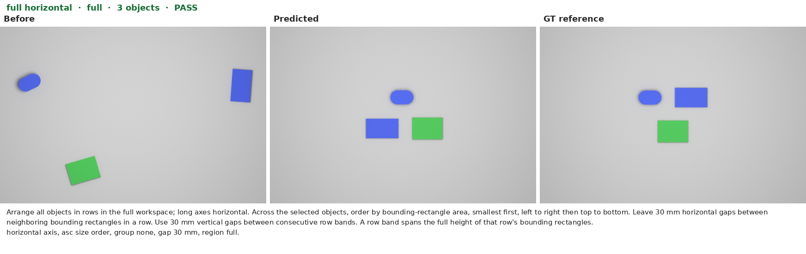
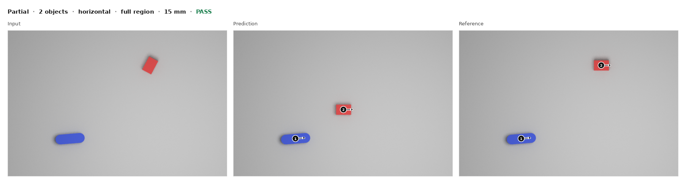
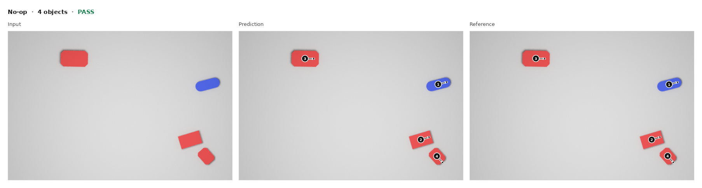

# Knolling Bot

Baseline **v2.0.0** predicts a target pose for every detected object from a
top-down RGB image and one English instruction. The pose is an `(x, y, θ)`
placement in the workspace. The reported score is accuracy of that prediction
on synthetic images. It is not a robot-arm execution rate.

Tag `v1.0.0` is the previous baseline. New training belongs on
`dev/knolling-v3` and needs a new development set plus a separate unused final
test. The 640-scene holdout below, and the official 2,000-scene test split,
are closed.

## Project overview

Knolling means arranging loose objects into aligned, evenly spaced rows. This
repository is the perception-to-pose system for that task. A camera image and
a sentence go in. A pose for each object comes out. No ground-truth pose, row,
or teacher layout is read at inference time.

Three instructions are supported, for 1 to 8 objects:

| Mode | Instruction | What moves |
| --- | --- | --- |
| Full | starts with `Arrange all objects` | every object |
| Partial | `Arrange only the red objects` (or green, or blue) | that color; the rest stay |
| No-op | `Keep every object at its current position and orientation.` | nothing |

The sentence also names the region (`full workspace`, `left region`,
`right region`), the gap (`Leave 15 mm`, `20 mm`, or `30 mm`), whether rows
are single-color, the size order, and whether long axes are horizontal or
vertical.

## Motivation and objective

A person can ask for a tidy arrangement in ordinary language: put everything
in rows, move only the red objects, or leave the scene alone. The objective is
to carry that request from a single overhead image to a target pose per
object, including the decision to move nothing. The system has to respect
color grouping, size order, gaps, and the named region, and it has to refuse
to invent a pose from the answer key.

## End-to-end pipeline

```text
BEV RGB (576×384) ──► RT-DETR detector
                         │  center, size, angle, color, shape
English instruction ──► text encoder ──► goal vector (13-d)
                         │
                         ├─ full ──► relation features ──► row and order selector
                         │              constrained decode (K = 8)
                         │              geometry decoder (x, y, axis)
                         │              row repair, then single-color split
                         │
                         └─ partial / no-op ──► move the named color, or keep all
                                                held objects stay on the detected pose
```

The geometry decoder only solves coordinates. It snaps an axis that is already
within 2°, opens a gap that is short of the request when the row still fits,
and leaves a layout that is already legal. If a row does not fit the region,
at most eight selector-ranked splits are tried. If a row mixes colors after
the sentence asked for single-color rows, the same limit applies to color-pure
splits. A layout that is already legal is not rewritten. Nothing in this path
reads a ground-truth pose.

## Dataset

`artifacts/generalization_20000/dataset` has **4,000 scene families** and
**20,000 samples**. Each family is one RGB image and five instructions that
share it: a horizontal full arrangement, a vertical-axis full arrangement, a
one-color partial arrangement, a keep-all no-op, and one contrasting full
instruction. Object counts run from 2 to 8.

| Split | Samples | Families |
| --- | ---: | ---: |
| train | 16,000 | 3,200 |
| validation | 2,000 | 400 |
| test | 2,000 | 400 |

The split is fixed by the family index: blocks of twenty families, eight for
train, one for validation, one for test. Images are 576×384. The workspace is
0.60 m by 0.40 m. Objects are rendered boxes, chamfers, and capsules in red,
green, and blue.

The number in the results section is **not** this test split. It is a later
holdout, `artifacts/v2_independent_eval`: 128 new families (`v2hold_`), 640
samples, drawn from development assets that the 20,000-scene set never uses.
Scene families, RGB hashes, and asset families do not overlap train,
validation, or test. That holdout has been scored once and is not for training
or for choosing a threshold.

## Model components

| Piece | Role | Weight file |
| --- | --- | --- |
| RT-DETR-R18 | detect objects in the BEV image | perception checkpoint in `configs/structural_integration.json` |
| Text encoder | `paraphrase-multilingual-MiniLM-L12-v2` | cached with the arrangement checkpoint |
| Goal encoder | instruction and objects to a 13-d command | arrangement / joint checkpoint |
| Relation head | features for the row selector | `artifacts/phase1_relation_continue/checkpoint-best.pt` |
| Row selector | row and slot scores | `artifacts/experiments/selector_full/checkpoint-best.pt` plus `selection-head.pt` |
| Size head | residual on the detected box | `artifacts/experiments/joint_stage/checkpoint-best.pt` |
| Direction head | keep-angle fallback on partial and no-op | `artifacts/experiments/selector_full/direction-head.pt` |
| Geometry decoder and constrained decode | coordinates and legal rows | code, not a separate checkpoint |

`load_adopted` in `experiments/end_to_end/score_end_to_end.py` is the loader.
The foreground threshold is **0.5**. SHA-256 hashes are in
[docs/v2.0.0.md](docs/v2.0.0.md). `/tmp/size_head.pt` is not part of this
release.

## Installation and requirements

Python 3.12. Inference needs an NVIDIA GPU, PyTorch 2.9.1 with CUDA, and the
neural extra:

```bash
python -m pip install -e ".[neural,test]"
```

Pinned versions that this release was run with are in
`requirements-neural-lock.txt` (PyTorch 2.9.1, torchvision 0.24.1,
transformers 4.57.3). Regenerating images also needs Blender on `PATH` or
`BLENDER_EXECUTABLE`.

Set the caches before importing the model:

```bash
export HF_HOME=/workspace/cache/huggingface
export TORCH_HOME=/workspace/cache/torch
export HF_HUB_OFFLINE=1
export TRANSFORMERS_OFFLINE=1
export CUBLAS_WORKSPACE_CONFIG=:4096:8
```

## Inference

Images are float tensors shaped `[batch, 3, 384, 576]` with values in `[0, 1]`.
One English sentence is required per image. From the repository root:

```python
import run_phase1_pairwise_affine as runner
from knolling_model.experiments.size_refinement import poses_from_detection
from score_end_to_end import load_adopted

runner.setup()
system, relation, model, head, _saved = load_adopted()
output, objects, visual = poses_from_detection(
    system, relation, model, images, texts, head)
```

`output['xy']` and `output['angle']` are the target pose in metres and radians.
`PYTHONPATH` must include `src`, `scripts`, and `experiments/end_to_end`, which
is how the scoring script below is launched.

`experiments/end_to_end/demo.py` renders one **full** arrangement beside the
input photo. Partial and no-op are not handled by that script; use
`poses_from_detection` for those.

## Evaluation and results

A prediction passes only when every check passes. The tolerances are keep
1 mm and 1°, axis 2°, gap 2 mm, row alignment 2 mm, and clearance and boundary
10 mm. Count must match. Gaps are measured on the rotated bounding rectangle,
not on the chamfer or capsule silhouette.

On the 640-scene holdout, scored once with those tolerances:

| System | Full | Partial | No-op | Overall |
| --- | ---: | ---: | ---: | ---: |
| v1.0.0 | 287/384 | 84/127 | 118/129 | 489/640 (76.4%) |
| v2.0.0 | 311/384 | 104/127 | 125/129 | 540/640 (84.4%) |

v2 kept every v1 success and added 51. Across the 128 families the difference
is +8.0 percentage points, with a family bootstrap 95% interval of +4.8 to
+11.6. Twenty-nine families improved and none got worse.

This is **target-pose accuracy on synthetic RGB**. It is not the rate at which
a robot arm would complete the arrangement.

Reproduce that table only. Do not use the output to change a weight or a
threshold:

```bash
python experiments/end_to_end/score_holdout.py \
  --code-root . \
  --data artifacts/v2_independent_eval \
  --output /tmp/v2_holdout.jsonl
```

Files under `docs/recovery-*` and `docs/perception-*` are earlier research
logs. Their figures are not this result.

## Demo examples

Ten validation scenes, chosen to show the three commands and a few failures.
Seven pass and three fail. That is not a success rate. The panels were
rendered at `26dca53` and are kept unchanged.

[Gallery](docs/v2.0.0/demo-gallery/index.html) ·
[contact sheet](docs/v2.0.0/demo-gallery/contact_sheet.png) ·
[summary](docs/v2.0.0/demo-gallery/summary.json)







## Repository map

| Path | What it is |
| --- | --- |
| `src/knolling_dataset/` | scenes, English instructions, teacher, renderer, validator |
| `src/knolling_model/` | detector, goal encoder, arrangement, adopted inference |
| `experiments/end_to_end/` | loader, holdout score, demo |
| `configs/structural_integration.json` | perception and arrangement base paths and hashes |
| `tests/` | unit and regression tests |
| `docs/v2.0.0.md` | release record, hashes, and the closed-data rule |
| `scripts/` | training runners that produced the frozen checkpoints |

Rejected row-layout trials are not on `main`. They remain on
`archive/e2e-routing-experiments` and `archive/e2e-failed-experiments`.

## Limitations

Spacing is still the main residual error. The evaluator measures the rotated
rectangle of each object. A chamfer or capsule is smaller in the image than
that rectangle, so a pixel outline does not recover the rectangle the checker
uses. Detection can still miss or duplicate an object. The system does not
plan a grasp or drive a robot. Weights and both datasets are local files, not
part of this Git history.

## Reproducibility

Checkpoint and dataset SHA-256 values are listed in
[docs/v2.0.0.md](docs/v2.0.0.md). Place those files at the recorded paths
before loading the model. **No public download is wired up.** This machine has
no Hugging Face token and no rclone remote, and GitHub does not store the
checkpoints or the RGB datasets. Without a separate copy of those files, the
commands above cannot be rerun from the repository alone.

The annotation hash of the 20,000-scene set is
`3e44cc3b623efa56d86a638d1f7fed51c0b4fd2e397a17ed72274e77d5509a04`.

## References and licenses

- Yian Zhao, Wenyu Lv, Shangliang Xu, Jinman Wei, Guanzhong Wang,
  Qingqing Dang, Yi Liu, and Jie Chen. *DETRs Beat YOLOs on Real-time
  Object Detection* (RT-DETR). CVPR 2024. Detector weights:
  [`PekingU/rtdetr_r18vd_coco_o365`](https://huggingface.co/PekingU/rtdetr_r18vd_coco_o365),
  revision `386c438`. Loaded through Hugging Face `transformers` 4.57.3
  (Apache-2.0).
- Reimers and Gurevych. Sentence-BERT. EMNLP 2019. Text encoder:
  [`sentence-transformers/paraphrase-multilingual-MiniLM-L12-v2`](https://huggingface.co/sentence-transformers/paraphrase-multilingual-MiniLM-L12-v2),
  revision `e8f8c211`. The `sentence-transformers` weights and library are
  Apache-2.0.
- PyTorch and torchvision, BSD-3-Clause. NumPy, BSD-3-Clause. Pillow, MIT-CMU.
  Shapely, BSD-3-Clause. SciPy, BSD-3-Clause.
- Blender is used only as an external renderer when a dataset is generated.
  Blender is GPL-2.0-or-later and is not vendored here.

Project code in this repository is the authors' research code. Third-party
packages keep the licenses above.
