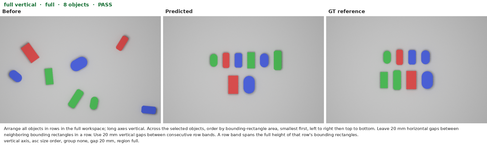
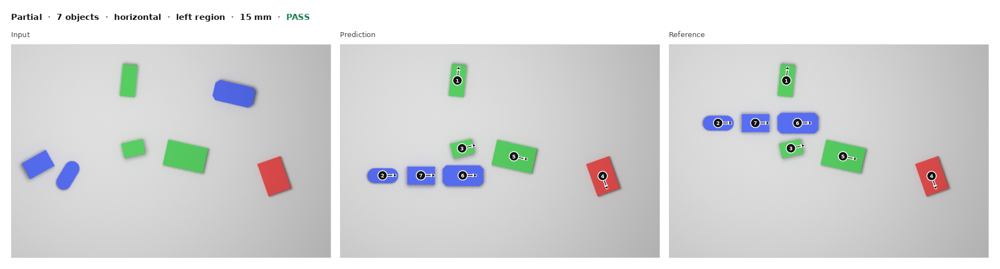

# Knolling Bot

Knolling Bot arranges scattered objects into aligned, evenly spaced rows from a
single overhead photograph and one English instruction. The system returns a
target pose `(x, y, θ)` for every detected object. It covers three requests:
arrange everything, move only one named color, or leave the scene unchanged.
Inference uses the image and the sentence. It does not read a ground-truth
pose, a teacher row, or a teacher order.

## End-to-end architecture

A 576×384 bird's-eye image is detected with RT-DETR. The sentence is encoded
and turned into a goal: which objects move, which region, which gap, whether
rows are single-color, and how the long axes should point. A neural selector
proposes rows. Constrained decoding keeps only legal candidates, and a
geometry decoder writes the coordinates. Partial and no-op instructions leave
the remaining objects on the pose the detector already saw.

```text
RGB  ──► RT-DETR ──► objects
text ──► goal ──► selector ──► constrained rows ──► geometry decoder
```

Module roles, the 13-dimensional goal, and the repair rules are in
[docs/architecture.md](docs/architecture.md).

## Current release

**v2.0.0 (Current Release)** is the system described above. `v1.0.0` is the
initial baseline, kept so the comparison below can be reproduced.

Both systems were scored once on the same sealed holdout: 128 scene families,
640 synthetic images. A prediction counts as correct only when every pose
check passes. The rate is **target-pose accuracy on synthetic RGB**. It is
not the rate at which a robot arm would complete the arrangement.

| System | Full | Partial | No-op | Overall |
| --- | ---: | ---: | ---: | ---: |
| v1.0.0 (Initial Baseline) | 287/384 | 84/127 | 118/129 | 489/640 (76.4%) |
| v2.0.0 (Improved System) | 311/384 | 104/127 | 125/129 | 540/640 (84.4%) |

v2.0.0 kept every v1.0.0 success and added 51 scenes. Tolerances, the
family-level interval, and the scoring command are in
[docs/evaluation.md](docs/evaluation.md).

| Mode | Instruction | Objects that move |
| --- | --- | --- |
| Full | begins with “Arrange all objects” | all |
| Partial | “Arrange only the red objects” (or green, or blue) | that color |
| No-op | “Keep every object at its current position and orientation.” | none |

The sentence also names the region, a 15/20/30 mm gap, color grouping, size
order, and axis direction. Wording and the data split are in
[docs/dataset.md](docs/dataset.md).

## Quick start

Python 3.12 and a CUDA GPU. Locked versions are in
`requirements-neural-lock.txt`.

```bash
python -m pip install -e ".[neural,test]"
```

Checkpoints and datasets are not in this repository. Paths, hashes, and the
`load_adopted` / `poses_from_detection` call are in
[docs/reproducibility.md](docs/reproducibility.md).

## Representative demos

The figures below are the harder scenes already saved in the demo gallery:
eight objects arranged at once, and seven objects with only one color moved.
They are examples, not a success rate. The same caveat applies as above: the
panels compare predicted poses on synthetic RGB with a reference render. They
are not robot executions.





The saved gallery has no 7- or 8-object no-op pass, so that case is not shown
as a figure. The no-op pass it does contain has four objects:
[No-op · 4 objects · PASS](docs/v2.0.0/demo-gallery/09_no_op_pass.png).
The smaller
[3-object full pass](docs/v2.0.0/demo-gallery/index.html#demo-01)
stays in the gallery and is not the lead example.

A representative failure is the six-object full scene that misses the
horizontal and vertical gaps:
[Full · 6 objects · FAIL](docs/v2.0.0/demo-gallery/04_full_fail.png).

All ten panels are in the [demo gallery](docs/v2.0.0/demo-gallery/index.html).

## Repository

| Path | Role |
| --- | --- |
| `src/` | model, data, and inference |
| `configs/` | checkpoint pins the loader still opens |
| `experiments/end_to_end/` | adopted loader, holdout scoring, demo |
| `tests/` | unit and regression tests |
| `docs/` | architecture, data, evaluation, reproducibility |
| `archive/` | earlier experiment notes |

Known limits, including the absence of robot execution, are in
[docs/limitations.md](docs/limitations.md). This repository does not yet
grant a license. Third-party terms are in
[docs/third-party-notices.md](docs/third-party-notices.md).
