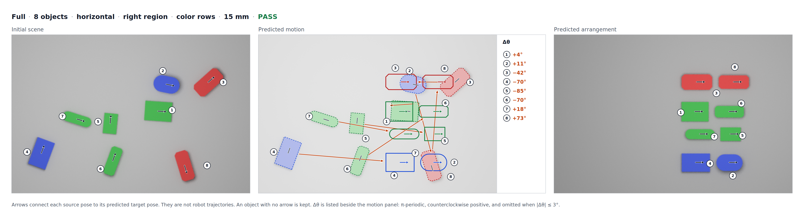

# Knolling Bot

Knolling Bot predicts a target pose `(x, y, θ)` for every object in one overhead photograph, given a single English instruction. It can arrange every object, move only one named color, or leave the scene unchanged. Inference reads the image and the sentence. It does not read a ground-truth pose, a teacher row, or a teacher order.

## Key results

**v2.0.0** is the current system. **v1.0.0** is the initial baseline. Both were scored once on the same sealed holdout: 128 families and 640 synthetic images. A scene counts only when every pose check passes. The rate is target-pose accuracy on synthetic RGB, not a robot-arm success rate.

| System | Full | Partial | No-op | Overall |
| --- | ---: | ---: | ---: | ---: |
| v1.0.0 | 287/384 | 84/127 | 118/129 | 489/640 (76.4%) |
| v2.0.0 | 311/384 | 104/127 | 125/129 | 540/640 (84.4%) |

v2.0.0 kept every v1.0.0 success and added 51 scenes. Tolerances and the family-level interval are in [docs/evaluation.md](docs/evaluation.md).

## Representative demos

Three passing full arrangements, with different instructions. Each figure shows the initial scene, the predicted source-to-target motion, and the predicted arrangement. The arrows are not robot trajectories. These scenes are examples, not a sample of the holdout rate.


**Full · 8 objects · vertical**



**Full · 8 objects · horizontal · color rows**


**Full · 6 objects**

Partial, no-op, and failure cases are in the [demo gallery](docs/v2.0.0/demo-gallery/index.html).

## Method

A 576×384 bird's-eye image is detected with RT-DETR. The sentence is encoded as a 13-dimensional goal: which objects move, which region, which gap, whether rows are single-color, and how the long axes point. A selector proposes rows, constrained decoding keeps legal candidates, and a geometry decoder writes the coordinates. Objects that should stay put remain on the detected pose.

```text
RGB  ──► RT-DETR ──► objects
text ──► goal ──► selector ──► constrained rows ──► geometry decoder
```

- **Full.** The sentence begins with "Arrange all objects". Every object moves.
- **Partial.** "Arrange only the red objects", or green, or blue. Only that color moves.
- **No-op.** "Keep every object at its current position and orientation." Nothing moves.

The sentence also sets the region, a 15, 20, or 30 mm gap, color grouping, size order, and axis. At most eight objects are arranged. Module roles and the repair rules are in [docs/architecture.md](docs/architecture.md).

## Data

The training distribution is `artifacts/generalization_20000/dataset`: 4,000 families and 20,000 scenes, split 16,000 / 2,000 / 2,000. The 640-scene holdout, `artifacts/v2_independent_eval`, is a separate sealed set. It is not the 2,000-scene test split. Neither dataset is in this repository. The split, the English templates, and the file hashes are in [docs/dataset.md](docs/dataset.md) and [docs/v2.0.0.md](docs/v2.0.0.md).

## Installation and inference

Python 3.12 and a CUDA GPU. Locked packages are in `requirements-neural-lock.txt`.

```bash
python -m pip install -e ".[neural,test]"
```

Checkpoints and pretrained snapshots are not in git. Place them at the paths in [docs/v2.0.0.md](docs/v2.0.0.md). From the repository root, with `src`, `scripts`, and `experiments/end_to_end` on `PYTHONPATH`:

```python
import run_phase1_pairwise_affine as runner
from knolling_model.experiments.size_refinement import poses_from_detection
from score_end_to_end import load_adopted

runner.setup()
system, relation, model, head, _saved = load_adopted()
output, objects, visual = poses_from_detection(
    system, relation, model, images, texts, head)
```

`output["xy"]` and `output["angle"]` are the target pose. `texts` is one English sentence per image. Environment variables and the reason `scripts/run_*.py` is not a verified retrain recipe are in [docs/reproducibility.md](docs/reproducibility.md).

## Evaluation and reproducibility

The holdout was scored once. This repository records that measurement and does not repeat it. The scoring command, tolerances, and the rule against tuning on the holdout are in [docs/evaluation.md](docs/evaluation.md). Seeds, checkpoint hashes, and the regression tests are in [docs/reproducibility.md](docs/reproducibility.md).

## Documentation

- [Architecture](docs/architecture.md)
- [Dataset](docs/dataset.md)
- [Evaluation](docs/evaluation.md)
- [Reproducibility](docs/reproducibility.md)
- [v2.0.0 release note](docs/v2.0.0.md)
- [Limitations](docs/limitations.md)
- [Third-party notices](docs/third-party-notices.md)

The system stops at eight objects, and no robot arm has executed these poses. Weights cannot be downloaded from this repository. This repository does not yet grant a license.
