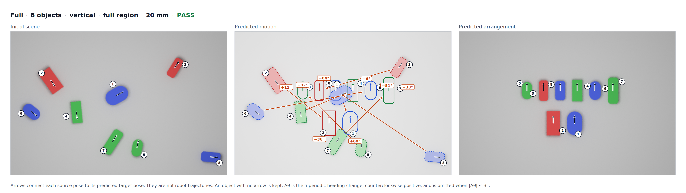
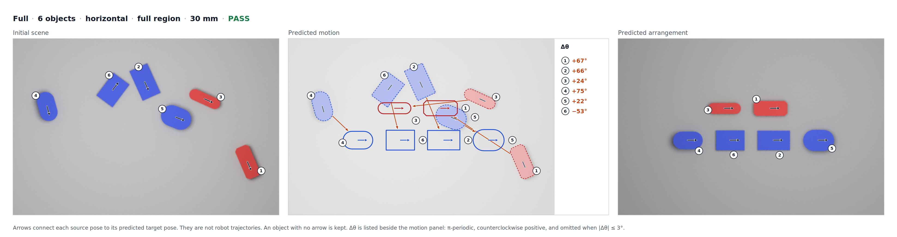

# Knolling Bot

Knolling Bot predicts a target pose `(x, y, θ)` for every object in one overhead RGB image, conditioned on one English instruction. The image is a 576×384 bird's-eye view of two to eight objects. The instruction asks the model to arrange every object, to move only one named color, or to leave the scene unchanged.

The system detects objects, predicts which objects share a row and in what order, and then places them with estimated sizes and the requested gap. Inference reads the photograph and the sentence. It does not read a ground-truth pose, a teacher row, or a teacher order.

This repository contains the code, configuration, tests, and demo gallery. Checkpoints, pretrained weights, and both datasets are in the [Google Drive release folder](https://drive.google.com/drive/folders/1o_0TrMCAHdPyOhf9d9EH-3aaB7na4_uX?usp=sharing).

## Results

v2.0.0 is the current system. v1.0.0 is the preceding baseline. Both were scored once, with the same evaluator, on a sealed holdout of 128 scene families and 640 image–instruction pairs. A scene counts only when every pose check passes. The rate is target-pose accuracy on synthetic RGB, not a robot-arm success rate.

| System | Full | Partial | No-op | Overall |
| --- | ---: | ---: | ---: | ---: |
| v1.0.0 | 287/384 | 84/127 | 118/129 | 489/640 (76.4%) |
| v2.0.0 | 311/384 | 104/127 | 125/129 | 540/640 (84.4%) |

v2.0.0 kept every v1.0.0 success and added 51 scenes (24 full, 20 partial, 7 no-op). The gain is 8.0 percentage points. A family bootstrap of 10,000 resamples, seed 20261112, gave a 95% interval of +4.8 to +11.6. Twenty-nine families improved and none got worse. Spacing accounts for 71 of the 100 remaining v2.0.0 failures. Tolerances are in [docs/evaluation.md](docs/evaluation.md). See [Limitations](docs/limitations.md) for the scope of these results.

## Examples

Three passing full arrangements. Each figure shows the initial scene, the predicted source-to-target motion, and the predicted arrangement. An arrow is not a robot trajectory. These scenes are examples, not a sample of the holdout rate.

**Full · 8 objects · vertical · full region · 20 mm**



**Full · 8 objects · horizontal · right region · color rows · 15 mm**


**Full · 6 objects · horizontal · full region · 30 mm**



Partial, no-op, and failure cases are in the [demo gallery](docs/v2.0.0/demo-gallery/index.html).

## Model

RT-DETR-R18 detects each object and estimates its center, size, angle, color, and shape. MiniLM encodes the instruction. The goal encoder turns that encoding into a 13-dimensional goal: whether to keep the scene, the region, the gap (15, 20, or 30 mm), color grouping, size order, and axis direction. A separate head names the objects that move. A selector proposes row membership and order. If that assignment is illegal, constrained decoding tries other high-scoring assignments, at most eight, and adopts the first legal one. That eight is the search width, not the number of objects. A geometry decoder then writes coordinates from the estimated sizes and the requested gap. Objects the instruction does not move stay on the detected pose.

```text
RGB  ──► RT-DETR-R18 ──► objects
text ──► MiniLM ──► goal encoder ──► 13-d goal ──► selector ──► constrained rows ──► geometry decoder
```

The released system accepts three instructions:

- **Full.** The sentence begins with "Arrange all objects". Every object moves.
- **Partial.** "Arrange only the red objects", or green, or blue. Only that color moves.
- **No-op.** "Keep every object at its current position and orientation." Nothing moves.

Details are in [docs/architecture.md](docs/architecture.md).

## Install the release files

Checkpoints, pretrained weights, and both datasets are not in git. Download the [release folder](https://drive.google.com/drive/folders/1o_0TrMCAHdPyOhf9d9EH-3aaB7na4_uX?usp=sharing), then run this from the repository root. `RELEASE` is that downloaded folder.

```bash
RELEASE=/path/to/release
mkdir -p artifacts/generalization_20000/dataset artifacts/v2_independent_eval /workspace/cache
rsync -a "$RELEASE/01_v2_inference/repo_overlay/" ./
rsync -a "$RELEASE/01_v2_inference/huggingface/" /workspace/cache/huggingface/
rsync -a "$RELEASE/02_dataset_20000/dataset/" artifacts/generalization_20000/dataset/
rsync -a "$RELEASE/03_holdout_640/" artifacts/v2_independent_eval/
```

`01_v2_inference` is the checkpoints and pretrained weights, `02_dataset_20000` is the 20,000-pair corpus, and `03_holdout_640` is the separate 640-pair holdout in the table above. Hashes and the file inventory are in [docs/v2.0.0.md](docs/v2.0.0.md). The corpus and the holdout are described in [docs/dataset.md](docs/dataset.md).

## Setup

Python 3.12 and an NVIDIA GPU. Locked versions are in `requirements-neural-lock.txt` (PyTorch 2.9.1, torchvision 0.24.1, transformers 4.57.3).

```bash
python -m pip install -e ".[neural,test]"
export HF_HOME=/workspace/cache/huggingface
export TORCH_HOME=/workspace/cache/torch
export HF_HUB_OFFLINE=1
export TRANSFORMERS_OFFLINE=1
export CUBLAS_WORKSPACE_CONFIG=:4096:8
export PYTHONPATH=src:scripts:experiments/end_to_end
```

## Inference

From the repository root, after the exports above, this runs one holdout scene:

```python
import json
from pathlib import Path

import numpy as np
from PIL import Image

import run_phase1_pairwise_affine as runner
import run_relation_stable as stable
from knolling_model.experiments.size_refinement import poses_from_detection
from score_end_to_end import load_adopted

runner.setup()
system, relation, model, head, _saved = load_adopted()

root = Path("artifacts/v2_independent_eval")
family = json.loads(sorted((root / "families").glob("*/family.json"))[0].read_text())
record = family["records"][0]
with Image.open(root / record["source_render_dir"] / "rgb.png") as image:
    pixels = stable.torch.from_numpy(np.array(image, copy=True)).permute(2, 0, 1).float() / 255

output, objects, visual = poses_from_detection(
    system, relation, model, pixels[None].to(stable.DEVICE),
    [record["instruction"]["text"]], head)
print(output["xy"])
print(output["angle"])
```

This example is complete: it loads one holdout image and its instruction, then prints the target pose. `output["xy"]` and `output["angle"]` are in metres and radians.

## Evaluation

The 540/640 figure is the stored measurement. This command repeats it and refuses the 20,000-pair corpus:

```bash
python experiments/end_to_end/score_holdout.py \
  --code-root . \
  --data artifacts/v2_independent_eval \
  --output /tmp/v2_holdout.jsonl
```

Run it from the repository root. The script sets its own `PYTHONPATH` and cache variables. Scoring rules are in [docs/evaluation.md](docs/evaluation.md). Seeds, the checkpoint layout, and a smaller decoder test are in [docs/reproducibility.md](docs/reproducibility.md).

No robot arm has executed these poses. This repository has no `LICENSE` file and does not grant a license to reuse the project code. See [Third-party notices](docs/third-party-notices.md) for dependency and model-license information.
